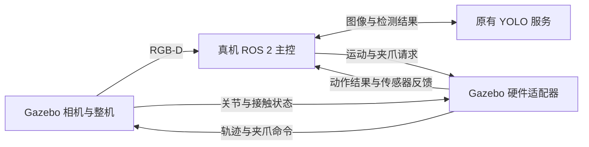

# 番茄采摘机器人 Gazebo 仿真

Gazebo 提供相机、轨道底盘、AUBO i5、剪夹末端和反馈信号。现有真机 ROS 2 主控接收仿真 RGB-D，调用原有 YOLO 服务，计算剪切点与进刀姿态，再通过原有 ROS 2 接口发出动作请求。Gazebo 适配器执行动作并回传状态。

项目实际存放在 `/data/tomato_gazebo`，可从 `~/tomato_gazebo` 进入。真机源码、场景、CAD 和 YOLO 权重都在项目目录内。系统 ROS 2、Gazebo 及 YOLO 的 Conda 基础环境由本机提供。

**当前验收进度**　v4 静止装配和实时 RGB-D 已通过。Phase 4 已跑通取图、YOLO 请求和检测响应。最近记录中果梗检出为 0，流程停在生成剪切点之前，剪切和入筐仍待通过。 [静止装配报告](ros2_gazebo_ws/docs/evidence/v4_static_2026-11-20.json) · [Phase 4 报告](ros2_gazebo_ws/docs/evidence/v4_phase4_2026-11-20.json)

## 快速开始

| 目的 | 入口 |
| --- | --- |
| 打开 Gazebo，查看 v4 地图、机器人和右侧相机 | [打开 Gazebo 界面](#打开-gazebo-界面) |
| 确认构建、静止装配和 RGB-D 正常 | [自动验收 v4 基线](#自动验收-v4-基线) |
| 用现有真机主控和 YOLO 驱动采摘联调 | [运行 Phase 4](#运行-phase-4) |

### 打开 Gazebo 界面

本机已构建过工作区。首次部署或修改 ROS 包后，先执行 [构建步骤](#环境与构建)。

```bash
cd ~/tomato_gazebo/ros2_gazebo_ws
source /opt/ros/humble/setup.bash
source .overlay/install/local_setup.bash
export ROS_LOCALHOST_ONLY=1 ROS_DOMAIN_ID=83
export GAZEBO_MASTER_URI=http://127.0.0.1:11673 GAZEBO_IP=127.0.0.1
ros2 launch tomato_sim_gazebo baseline.launch.py gui:=true
```

该入口启动 v4 场景、整机、控制器和仿真适配器。按 `Ctrl+C` 停止仿真。要查看 v5，保留上述环境设置，把最后一条命令替换为下方命令。v5 用于查看更新后的果梗外形，采摘验收采用 v4。

```bash
ros2 launch tomato_sim_gazebo baseline.launch.py gui:=true \
  world:=/data/tomato_gazebo/gazebo_migration/tomato_corridor_v5.world
```

### 自动验收 v4 基线

```bash
cd ~/tomato_gazebo/ros2_gazebo_ws
./verify_v4_baseline.sh
```

脚本会构建工作区并启动无界面仿真，检查 180° 安装偏航、60 株植株、轨道实体、底盘水平、静止关节反馈和实时 RGB-D。每次运行默认在 `validation/v4_baseline/<运行标识>/` 下创建独立目录，终端会打印该目录。

| 文件 | 内容 |
| --- | --- |
| `status.txt`、`summary.json` | 验收结果和测量值 |
| `dependencies.json`、`world.json` | 真机源码、地图和权重指纹，以及实际启动的世界 |
| `build.log`、`launch.log` | 构建和仿真启动日志 |
| `gazebo_v4_rgb.png`、`gazebo_v4_robot_overview.png` | 作业相机画面与整机俯视图 |

### 运行 Phase 4

```bash
cd ~/tomato_gazebo/ros2_gazebo_ws
./verify_phase4.sh
```

脚本先生成 v4 采摘场景副本并等待四个控制器激活，再从仿真 TF 生成手眼标定文件，依次启动原 YOLO 和真机主控。主控使用右侧相机，`16UC1` 对齐深度的比例为每个计数 1 mm。脚本直接调用配置中的两套 Python，无需提前激活 Conda。

验收阶段默认观察 480 秒。只检查进程启动和取图时，可缩短观察窗口。

```bash
PHASE4_TIMEOUT_S=60 ./verify_phase4.sh
```

结果写入工作区的 `validation/`。再次运行会更新同一阶段的固定文件名。

| 文件 | 内容 |
| --- | --- |
| `phase4_status.txt`、`phase4_summary.json` | 总结果、RGB 帧数、检测类别计数、TCP 误差和剪切状态 |
| `phase4_launch.log`、`phase4_controllers.log` | Gazebo、适配器与控制器的启动情况 |
| `phase4_main_control.log`、`phase4_yolo.log` | 相机内参、取图、YOLO 请求与响应、果梗和匹配数量 |
| `phase4_runtime.json`、`phase4/calibration/` | 接触、持果与释放状态，仿真手眼标定文件 |
| `phase4_rgb.png` | 验收采集到的作业相机画面 |

## 环境与构建

本机验证环境为 Ubuntu 22.04、ROS 2 Humble 和 Gazebo Classic 11.10.2。构建使用 `colcon`，整机描述使用 Xacro，控制器由 `gazebo_ros2_control` 加载。Gazebo 界面需要图形会话，自动验收可无界面运行。

| 用途 | 本机环境 |
| --- | --- |
| ROS 2、Gazebo 和构建 | 系统 ROS 2 安装位于 `/opt/ros/humble`，`gzserver` 位于 `/usr/bin` |
| 真机主控 | 工作区内的 `.venv_ros`，基于系统 Python 3.10.12，使用 ROS 2、`cv_bridge`、OpenCV 和 `pyrealsense2` |
| YOLO 和 Phase 1 独立 FK | 工作区内的 `.venv_yolo`，基于 Conda 的 `tomato_sim` 环境，Python 3.10.20，使用 PyTorch、Ultralytics、MuJoCo 和 SciPy |

```bash
cd ~/tomato_gazebo/ros2_gazebo_ws
source /opt/ros/humble/setup.bash
python3 scripts/prepare_overlay.py --check
./build_overlay.sh
source .overlay/install/local_setup.bash
```

依赖检查输出源码、地图和模型权重的实际路径及指纹。构建脚本准备仿真覆盖包，编译九个 ROS 2 包，并把产物写入 `.overlay/`。以后用 `.overlay/install/local_setup.bash` 加载这套构建。 [依赖与资产说明](ros2_gazebo_ws/docs/dependencies.md)

## 项目结构与控制链路

| 目录 | 职责 |
| --- | --- |
| `robot_ws_fixed-v1.0-master/` | 真机 ROS 2 工作区，提供主控、YOLO、ROS 消息和 AUBO 描述 |
| `ros2_gazebo_ws/src/tomato_sim_gazebo/` | 启动描述、基线配置和 Gazebo 初始关节插件 |
| `ros2_gazebo_ws/src/tomato_sim_description/` | 整机 Xacro、CAD 网格、相机和控制器配置 |
| `ros2_gazebo_ws/src/tomato_sim_adapters/` | 相机切换与深度转换、底盘、机械臂、夹爪和接触反馈 |
| `gazebo_migration/` | v4/v5 世界、场景模型和地图生成器，以及采摘副本所需的 v2 位姿和真值 |
| `assets/` | YOLO 权重和 Phase 1 使用的 FK/CAD 参考模型 |
| `ros2_gazebo_ws/.overlay/`、`ros2_gazebo_ws/validation/` | 生成的覆盖工作区，以及日志、图像、场景副本和验收报告 |

Phase 4 直接调用当前真机源码中的 `xc_robot_main_control_node` 和 `yolov8_service`。构建生成的软件包链接指向项目内的真机源码。仿真侧用 ROS 参数指定相机、标定文件和深度比例。机械臂适配器通过 KDL 解算，再通过 `ros2_control` 执行轨迹，进刀、退刀和回筐由适配器实现。 [装配与接口说明](ros2_gazebo_ws/README.md#资产与控制接口) · [真机源码与交付包的差异](ros2_gazebo_ws/docs/robot_source_workspace_2026-11-20.patch)



## 可调配置

基线集中在 `simulation_baseline.json`。地图轨道长 8 m，当前滑移关节范围为 ±2.5 m。Phase 3/4 候选工位仍待采摘验收。 [基线配置](ros2_gazebo_ws/src/tomato_sim_gazebo/config/simulation_baseline.json)

| 参数 | v4 静止装配 | Phase 3/4 候选工位 |
| --- | ---: | ---: |
| 轨道初始位置 | 0.30 m | 1.25 m |
| 升降高度 | 0 m | 0.50 m |
| 机械臂安装偏航 | 180° | 180° |
| 右侧相机偏角和仰角 | 14°、0° | 32°、25° |

| 环境变量 | 用途 |
| --- | --- |
| `TOMATO_ROBOT_SOURCE` | 指定真机工作区。默认使用项目内的 `robot_ws_fixed-v1.0-master/` |
| `TOMATO_GAZEBO_ASSETS` | 指定包含世界文件和 `assets/models` 的地图目录 |
| `TOMATO_YOLO_WEIGHTS` | 指定安装为 `best.pt` 的权重。默认使用项目内的 `assets/weights/` |
| `TOMATO_ROS_PYTHON`、`TOMATO_YOLO_PYTHON` | 分别指定主控和 YOLO 的 Python 可执行文件 |
| `SIM_RAIL_STATION_M`、`SIM_LIFT_HEIGHT_M` | 调整 Phase 3/4 的轨道工位和固定升降高度 |
| `SIM_CAMERA_ANGLE_DEG`、`SIM_CAMERA_TILT_DEG`、`SIM_CAMERA_HFOV_DEG` | 调整 Phase 3/4 的相机偏角、仰角和水平视场角 |
| `ROS_DOMAIN_ID`、`GAZEBO_PORT` | 调整静止验收和 Phase 3/4 的 ROS 域与 Gazebo 端口 |

## 分阶段验收

在 `~/tomato_gazebo/ros2_gazebo_ws` 运行所需的脚本，各阶段结果默认写入 `validation/`。

| 命令 | 检查内容 | 主要结果 |
| --- | --- | --- |
| `./verify_v4_baseline.sh` | v4 静止装配与实时 RGB-D | `v4_baseline/<运行标识>/` |
| `./verify_phase1.sh` | YOLO CPU 推理、URDF 与网格、独立 FK、相机、轨道、机械臂和夹爪 | `phase1_status.txt`、`phase1_summary.json` |
| `./verify_phase2.sh` | 相机深度比例、底盘、机械臂、夹爪和反馈接口 | `phase2_status.txt`、`phase2_summary.json` |
| `./verify_phase3.sh` | 通过场景真值检查接触判据、剪离、持果、释放和入筐 | `phase3_status.txt`、`phase3_summary.json` |
| `./verify_phase4.sh` | 从 YOLO 检测和现有真机主控发起完整采摘 | `phase4_status.txt`、`phase4_summary.json` |

v4 采摘副本通过了几何与 SDF 检查。Phase 1 的历史复验中，三路相机、滑轨和 TCP 检查通过，夹爪闭合位置误差超出原阈值。端到端采摘以 Phase 4 的剪切与入筐结果为准。 [v4 几何报告](ros2_gazebo_ws/docs/evidence/v4_harvest_geometry_2026-11-20.json) · [阶段验收记录](ros2_gazebo_ws/docs/dependencies.md#验收范围)

## 常见问题

| 现象 | 检查方式 |
| --- | --- |
| 找不到 `tomato_sim_gazebo` 包 | 运行 `./build_overlay.sh`，依次加载系统 ROS 2 和 `.overlay/install/local_setup.bash` |
| 构建报告源码、模型或权重缺失 | 运行 `python3 scripts/prepare_overlay.py --check`，核对报错路径和当前环境变量 |
| Gazebo 端口占用 | 手动示例与 Phase 1/2 使用 11673，先退出占用端口的仿真。静止验收可用 `GAZEBO_PORT=11684 ./verify_v4_baseline.sh` |
| 界面打开但没有机器人，或控制器未就绪 | 检查启动日志中的世界路径、机器人生成和控制器激活信息。另开终端时加载相同 ROS 环境并使用同一 `ROS_DOMAIN_ID`，再运行 `python3 scripts/check_controllers.py` |
| Phase 4 收不到图像或检测响应 | 先看启动和控制器日志，再看主控和 YOLO 日志。相机输入为 `/camera/color/image_raw` 和 `/camera/aligned_depth_to_color/image_raw`，检测服务为 `/yolo_detection` |
| 有检测响应但剪夹没有动作 | 查看 `phase4_summary.json` 的 `peak_detection_boxes_per_class.stem` 和 `vision`，确认是否检出了果梗并生成了剪切点 |

在另一台机器部署时，需要准备同一套 ROS 2/Gazebo 依赖、真机工作区、地图模型、CAD 网格、YOLO 权重和两套 Python 环境。Git 跟踪仿真代码、配置、世界文件和小型验收记录，部署所需的大文件及虚拟环境需随本地项目另行提供。 [地图资产与重建说明](gazebo_migration/README.md)
