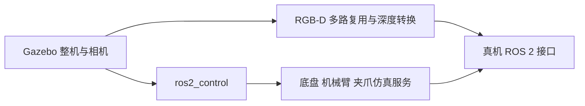

# 番茄采摘机器人 ROS 2 与 Gazebo 仿真工作空间

工作空间位于 `/data/tomato_gazebo/ros2_gazebo_ws`。当前基线是用户提供的 `gazebo_migration/tomato_corridor_v4.world`，保留 **180° 机械臂安装朝向**。平台使用 ROS 2 Humble、Gazebo Classic 11 和 `gazebo_ros2_control`。

切换说明、实测证据、真机源码复用边界与采摘状态见 [v4 仿真基线与采摘迁移](docs/v4_baseline_2026-11-20.md)。静止装配复验入口为 `./verify_v4_baseline.sh`。

## 配置和构建

依赖路径与地图、机械臂安装角和候选采摘工位集中在 [simulation_baseline.json](src/tomato_sim_gazebo/config/simulation_baseline.json)。相对路径以联调工作区为基准，可用下表的环境变量覆盖。

| 变量 | 配置内容 |
| --- | --- |
| `TOMATO_ROBOT_SOURCE` | 新版真机工作区根目录，默认为项目内的 `robot_ws_fixed-v1.0-master/` |
| `TOMATO_GAZEBO_ASSETS` | 地图根目录，包含 v4 世界、`assets/models`、v2 世界和真值文件 |
| `TOMATO_YOLO_WEIGHTS` | 安装为 `xc_robot_main_control/weights/best.pt` 的权重文件 |
| `TOMATO_ROS_PYTHON` | 主控 Python，需与 Humble ABI 兼容并可导入 OpenCV、`cv_bridge` 和 `pyrealsense2` |
| `TOMATO_YOLO_PYTHON` | YOLO 和 Phase 1 FK 的 Python，需支持 ROS 2、PyTorch、Ultralytics、MuJoCo 和 SciPy |

```bash
cd /data/tomato_gazebo/ros2_gazebo_ws
source /opt/ros/humble/setup.bash
python3 scripts/prepare_overlay.py --check
./build_overlay.sh
source .overlay/install/local_setup.bash
```

构建脚本根据配置生成 `.overlay/src` 及两个 Python 包的仿真打包覆盖，再构建九个包。准备步骤检查主要输入路径，记录真机版本与源码指纹、地图世界名与 SHA-256、权重 SHA-256 和 Python 入口。静止装配验收将依赖记录和实际启动的世界记录一并写入带运行时间的目录 `validation/v4_baseline/`。交付包来源、补丁和本机资产见 [依赖和版本管理](docs/dependencies.md)。

## Phase 1 和 Phase 2 验收

```bash
cd /data/tomato_gazebo/ros2_gazebo_ws
./verify_phase1.sh
./verify_phase2.sh
```

两条命令均会编译工作空间，启动独立的仿真进程，执行验收并退出。各次运行保存结构化结果、ROS 2 命令行输出与 Gazebo 日志到 `validation/`。查看对应的 `phase1_status.txt` 或 `phase2_status.txt` 判断最近一次运行结果。Phase 1 使用项目内的参考模型独立计算 MuJoCo FK，并测试 YOLOv8。可通过 `TOMATO_YOLO_PYTHON` 指定 Python，兼容此前的 `TOMATO_SIM_PYTHON` 变量。Phase 2 使用系统的 PyKDL。

| 验收内容 | 证据 |
| --- | --- |
| Phase 1 构建和控制器 | `phase1_build.log`、`controllers.log` |
| 零位与两个非零位的 TCP | `phase1_summary.json`、`fk_reference.json`、`tf2_echo_zero.log`、`tf2_echo_pose_a.log`、`tf2_echo_pose_b.log` |
| 轨道正反向、机械臂动作、双刀爪与 Gazebo 接触数据 | `phase1_summary.json`、`gazebo_contacts.log` |
| 安装目录里的旧 YOLOv8 模型 | `yolov8_weights.sha256`、`yolov8_inference.log` |
| Phase 2 相机反投影、AGV、机械臂和夹爪服务 | `phase2_summary.json`、`phase2_cli.log` |

## 手动启动

```bash
cd /data/tomato_gazebo/ros2_gazebo_ws
source /opt/ros/humble/setup.bash
source .overlay/install/local_setup.bash
export ROS_LOCALHOST_ONLY=1 ROS_DOMAIN_ID=83
export GAZEBO_MASTER_URI=http://127.0.0.1:11673 GAZEBO_IP=127.0.0.1
export GAZEBO_MODEL_DATABASE_URI=
ros2 launch tomato_sim_gazebo baseline.launch.py gui:=true
```

`baseline.launch.py` 从 `src/tomato_sim_gazebo/config/simulation_baseline.json` 读取 v4 静止装配配置，默认启用右侧场景相机。v5 可通过 `world:=` 显式选择，用于查看。`lift_height` 是启动时固定的装配参数。v4 可见轨道长 8 m，当前滑移关节仍限制在 ±2.5 m，轨顶基准为 0.040 m。原地图只读，启动生成的副本只加入 Gazebo ROS 状态插件。

## 资产与控制接口

| 部件 | 实现 |
| --- | --- |
| AUBO i5 | `aubo_description` 打包真机机械臂 URDF 和网格，通过独立 Xacro 宏装入整机 |
| 底盘、升降台、筐、剪夹末端 | `export_mujoco_geometry.py` 从 `tomato_picker_standalone.xml` 和原 STL 导出外观，Gazebo 接触采用若干简化包络。筐固定在底盘上，位置采用旧场景零升降高度的 CAD 基准 |
| TCP | `wrist3_Link → flange_link → cutter_base_link → tool_tcp`，剪口校准引用旧工程的 `contact_tcp` |
| 轨道 | `machine_slide` 由 `slide_velocity_controller` 控制，命令为 m/s |
| 底盘轮组 | 两个主动轮和八个从动轮均有独立关节、碰撞体和关节状态。主动轮速度控制器按 `act_left_joint`、`act_right_joint` 顺序接收 rad/s。 |
| 机械臂 | `arm_trajectory_controller` 接收六关节 `FollowJointTrajectory` |
| 刀爪 | `gripper_controller` 控制齿轮轴，两片刀爪按 MuJoCo 的比例映射同步移动 |
| 相机 | 两个侧向 L515 和腕部 D405，以 `libgazebo_ros_camera.so` 发布原始 RGB-D |

真机业务源码通过软链接参与编译。仿真工作空间中的两个本地打包覆盖只安装实际存在的权重，并解除真机 RealSense 驱动的打包依赖。`yolov8_service` 读取的 `weights/best.pt` 指向新项目的 `/data/tomato_gazebo/assets/weights/tomato-seg2025063018-yolov8-xucan.pt`。CPU 推理已确认它是分割模型，类别为 `stem`、`tomato`、`trunk`。腕部专用模型和 MoGe 文件仍待提供。本机权重来源见 [依赖和版本管理](docs/dependencies.md)。

AGV 启停指令同时给滑轨和两只主动轮下发速度。巡航默认速度为 `0.1 m/s`，等于 `10 cm/s`。车架平移由 `machine_slide` 驱动，从动轮通过接触自由转动。v4 轨道是视觉几何。

## Phase 2 服务

| 服务或话题 | 仿真语义 |
| --- | --- |
| `/control_agv`、`/agv_status` | 速度按 mm/s 与 m/s 换算，端点通过位置、方向及连续样本触发卡号 13、23 |
| `/agv_always_go_straght_node` 的 `is_continue_run` | 真机主控可用同名参数启动或暂停巡航 |
| `/move_joints`、`/move_to_pose`、`/target_return_midpoint`、`/return_to_box` | 使用真机消息定义及 AUBO URDF 的 KDL 解算。关节反馈到位并停稳后才返回成功。两段式先发布中间点事件，再由第二次调用发起插补 |
| `/arm_status`、`/midpoint_reached`、`/gripper/input_x1_status` | 笛卡尔位置为米，RPY 为弧度，状态中的六轴关节角为度。进刀期间转发模拟 X1 信号 |
| `/gripper/control` | 根据实测齿轮轴回报开合，目标脉冲为 600 和 2702 |
| `/camera` | 同步发布激活侧的 RGB、相机内参及深度。深度格式为 `16UC1`，单位为 0.25 mm，参数 `active_side` 支持实时切换 |
| `/cam_hand` | 发布腕部 RGB、相机内参及深度。深度格式为 `16UC1`，单位为 1 mm |

机械臂适配器在 `arm_base_link` 下以 `tool_tcp` 为运动目标。在 Phase 4 中，适配器换算真机主控发出请求时使用的 0.10 m 偏置。旧入筐路点是在默认升降高度下验证的，v4 采摘候选高度需要重新校验。Phase 2 的 X1 由测试节点注入；Phase 3/4 则由真实 Gazebo 接触与 TCP 判定生成。


